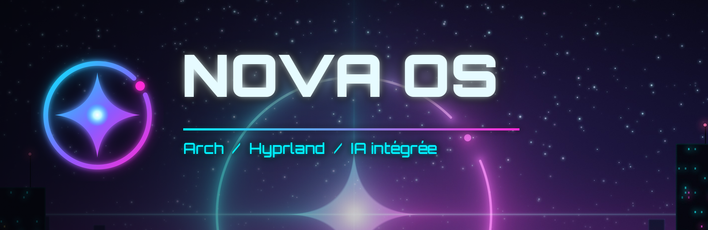
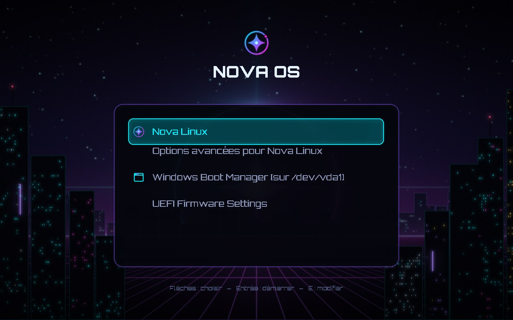
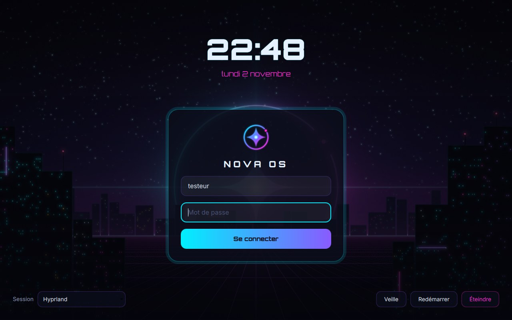
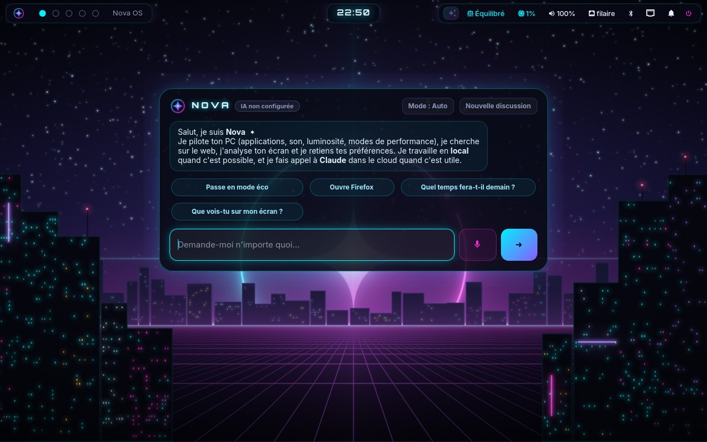
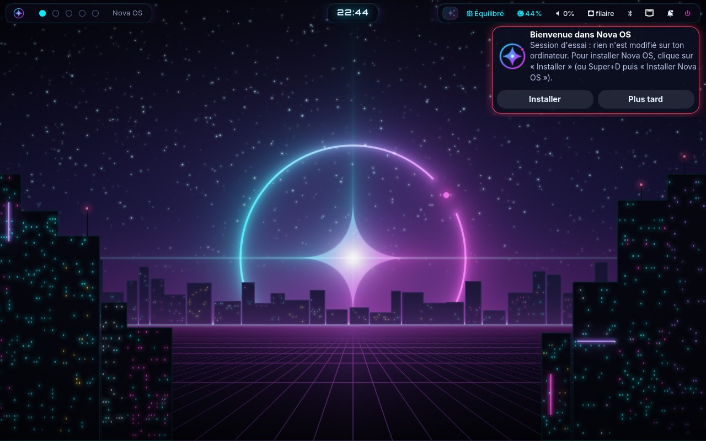

<p align="center">
  
</p>

<p align="center">
  <b>Le Linux ultra rapide, néon et futuriste, avec une IA intégrée.</b><br>
  Basé sur Arch Linux, optimisé façon CachyOS, bureau Hyprland, assistant Nova.
</p>

<p align="center">
  <a href="https://github.com/CorentinFriedmann/OS/actions/workflows/build.yml"></a>
  <a href="https://github.com/CorentinFriedmann/OS/releases/latest"></a>
</p>

---

| | |
|---|---|
|  |  |
|  |  |

<sub>Captures prises automatiquement à chaque version : Nova installé à côté de Windows dans une machine virtuelle, puis démarré.</sub>

## Ce que Nova OS apporte

- **⚡ Ultra performant** : noyau `linux-cachyos` (ordonnanceur BORE) avec un noyau LTS de secours,
  paquets recompilés pour ton processeur (x86-64-v3/v4, détecté tout seul), ordonnanceur
  sched-ext `scx_lavd`, mémoire compressée zram, réseau BBR, démarrage rapide.
  Quatre modes à la volée (**Super+M**) : Éco, Équilibré, Performance, Jeu.
- **✦ Nova, l'IA intégrée** (**Super+Espace**) : locale et privée par défaut, Claude en renfort
  pour le web, l'écran, le code et la rédaction. Elle pilote le PC (applications, fenêtres,
  son, modes, logiciels…) et demande confirmation avant toute action sensible.
  [En savoir plus](docs/assistant.md).
- **🌃 Bureau néon** : Hyprland en mosaïque, bordures en dégradé cyan → magenta, flou, lueurs
  et animations, réduites automatiquement sur batterie. Raccourcis pensés pour les habitués de
  Windows (Super+E, Super+L, Super+V, Super+Maj+S…). [Tous les raccourcis](docs/raccourcis.md).
- **🎮 Jeux** : Steam, Proton-CachyOS, GameMode, MangoHud, Gamescope, Lutris, Wine ;
  le mode Jeu (**Super+G**) coupe les effets et réduit la latence.
- **💻 Développement** : VS Code, Docker, Git, GitHub CLI, Neovim, Rust, Go, Node.js, Python.
- **🎬 Quotidien** : Firefox, LibreOffice, GIMP, OBS Studio, Spotify, Discord.
- **🛡 Sans risque** : s'installe **à côté de Windows sans le toucher**, instantanés automatiques
  avant chaque mise à jour et retour en arrière depuis le menu de démarrage.

Pensé d'abord pour un **PC portable Intel** (graphique intégré : pilotes vidéo et décodage
matériel, gestion thermique, économies d'énergie), il s'adapte aussi aux processeurs AMD et aux
cartes graphiques AMD et NVIDIA.

## Installer

1. Télécharge l'ISO sur la page [Releases](https://github.com/CorentinFriedmann/OS/releases/latest).
2. Libère au moins 30 Go (60 conseillés) depuis Windows, puis écris l'ISO sur une clé USB (Rufus).
3. Démarre sur la clé : essaie Nova sans rien modifier, puis clique sur **Installer**.

👉 **Le guide pas à pas : [installer Nova OS à côté de Windows](docs/installation.md)**
(BitLocker, démarrage rapide, BIOS, menu de démarrage, dépannage).

## Documentation

| | |
|---|---|
| [Installation à côté de Windows](docs/installation.md) | préparer Windows, créer la clé, installer, mettre à jour, revenir en arrière |
| [Nova, l'assistant IA](docs/assistant.md) | local ou cloud, ce qu'il sait faire, confidentialité, coûts, réglages |
| [Raccourcis clavier](docs/raccourcis.md) | fenêtres, bureaux, captures, outils (ou **Super+F1** dans Nova) |

## Comment c'est fait

| Dossier | Contenu |
|---|---|
| [`branding/`](branding) | logo, fonds d'écran générés, thème du menu de démarrage (GRUB), écran de démarrage (Plymouth), écran de connexion (SDDM) |
| [`desktop/`](desktop) | configuration Hyprland en Lua, Waybar, lanceur, notifications, verrouillage, terminal Ghostty, scripts `nova-*` |
| [`assistant/`](assistant) | Nova IA : démon, fenêtre GTK 4, commande `nova`, outils, moteurs Ollama et Claude, tests |
| [`system/`](system) | réglages de performance (noyau, mémoire, réseau, disques), modes, premier démarrage, dépôts CachyOS |
| [`installer/`](installer) | `nova-install` : installateur en français, dual-boot sans toucher à Windows, tests sur disques virtuels |
| [`packages/`](packages) | paquets Arch (`PKGBUILD`) : nova-branding, nova-desktop, nova-performance, nova-assistant, nova-installer |
| [`archiso/`](archiso) | image de la clé USB : session d'essai en français, bureau Nova, installateur |
| [`scripts/`](scripts), [`tests/`](tests) | construction des paquets et de l'ISO, test complet en machine virtuelle |

### Construire soi-même (sur Arch Linux)

```bash
scripts/build-packages.sh               # paquets + dépôt [nova] dans out/repo
sudo scripts/build-iso.sh               # ISO dans out/iso
sudo tests/vm/run.sh out/iso/*.iso out/vm   # installation + premier démarrage en VM
```

Tests rapides : `scripts/ci/lint.sh`, `cd assistant && python -m pytest`,
`sudo installer/tests/test-partitioning.sh`.

### Intégration continue

À chaque envoi sur GitHub, [le workflow](.github/workflows/build.yml) :

1. lance les tests (shellcheck, assistant, installateur sur disques virtuels) ;
2. construit les paquets et l'ISO dans un conteneur Arch Linux ;
3. démarre l'ISO dans une **machine virtuelle UEFI** avec un faux Windows 11, installe Nova
   **à côté**, vérifie que Windows est intact au bit près, redémarre sur le système installé
   et prend des captures (menu de démarrage, écran de connexion, bureau) ;
4. publie l'ISO et met à jour le dépôt de paquets `[nova]` (release `repo`) utilisé par les
   mises à jour.

Les journaux de chaque construction sont dans la release
[`ci-logs`](https://github.com/CorentinFriedmann/OS/releases/tag/ci-logs).

## État du projet

Nova OS est jeune (version 0.1) : chaque version est installée et démarrée automatiquement
dans une machine virtuelle, mais pas encore sur une grande variété de vrais PC.

- Le **démarrage sécurisé** (Secure Boot) doit être désactivé.
- Le dépôt de paquets `[nova]` est téléchargé en HTTPS depuis GitHub mais **n'est pas encore
  signé** (signature des paquets à venir).
- L'IA **locale** est gratuite ; **Claude** nécessite une clé d'API Anthropic (payante à l'usage).

Nova OS s'appuie sur [Arch Linux](https://archlinux.org), [CachyOS](https://cachyos.org),
[Hyprland](https://hypr.land), [Ollama](https://ollama.com) et [Claude](https://claude.com),
chacun sous sa propre licence. Police Orbitron : SIL Open Font License
([`branding/fonts/orbitron/OFL.txt`](branding/fonts/orbitron/OFL.txt)).
