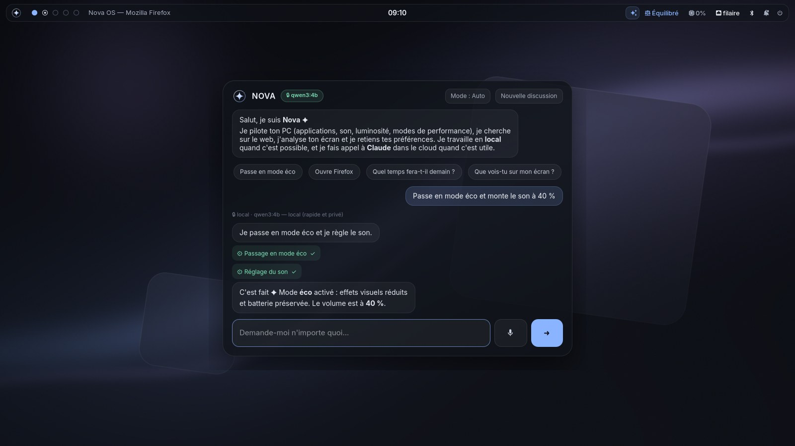

# Nova, l'assistant IA intégré

Nova est un assistant **hybride** :

- **en local** par défaut (modèle Qwen 3 via Ollama) : privé, gratuit, fonctionne sans internet ;
- **Claude** (Anthropic) en renfort quand c'est utile : recherche sur le web, analyse de l'écran,
  code, rédaction, raisonnement long.

Il ne se contente pas de répondre : il peut **agir sur ton PC** (ouvrir une application, régler
le son, ranger les fenêtres, chercher un fichier, installer un logiciel…), en te demandant
confirmation avant tout ce qui modifie le système.



## L'ouvrir

| Où | Comment |
|---|---|
| Partout | **Super+Espace** : la fenêtre de Nova s'ouvre par-dessus ton bureau (Échap pour la fermer) |
| À la voix | **Super+Maj+Espace** : tu parles, Nova répond à voix haute (voir plus bas) |
| Barre du haut | Clic sur l'orbe ✦ (elle pulse quand Nova réfléchit, et devient lavande quand Claude répond) |
| Terminal | `nova` pour discuter, ou `nova "ta question"` pour une question rapide |

Chaque réponse affiche un badge : **🔒 local** ou **☁ cloud**, pour savoir qui a répondu.

## Premier réglage : `nova setup`

Au premier démarrage, Nova se présente dans sa fenêtre. Pour la régler (une seule fois, et
autant de fois que tu veux ensuite) : **clic droit sur l'orbe ✦** de la barre du haut, ou
dans un terminal :

```bash
nova setup
```

1. **IA locale** : Nova choisit un modèle adapté à ta mémoire vive et le télécharge (une seule fois) :

   | Mémoire vive | Modèle local | Taille du téléchargement |
   |---|---|---|
   | moins de 12 Go | `qwen3:1.7b` | ~1,4 Go |
   | de 12 à 24 Go | `qwen3:4b` | ~2,6 Go |
   | 24 Go et plus | `qwen3:8b` | ~5 Go |

   Sur un portable avec graphique Intel intégré, le modèle tourne surtout sur le processeur :
   les petits modèles sont choisis pour rester rapides. Pour en changer : `nova model qwen3:8b`.

2. **Claude (facultatif)** : colle ta clé d'API Anthropic. Pour en créer une :
   [console.anthropic.com](https://console.anthropic.com) → *API Keys* → *Create Key*.
   La clé est rangée dans `~/.config/nova/secrets.env`, lisible par toi seul (droits 600),
   et n'est jamais affichée. Sans clé, Nova fonctionne entièrement en local.

## Local ou cloud : qui répond ?

En mode **auto** (par défaut), Nova choisit pour toi :

- **en local** : piloter le PC, questions courtes, conversation ;
- **avec Claude** : tout ce qui demande internet (actualité, météo, prix, horaires…), l'analyse
  de l'écran, le code, les explications détaillées, la rédaction (lettre, e-mail, résumé,
  traduction…), ou les demandes très longues ;
- une question courte juste après une réponse de Claude reste chez Claude (suite de la discussion).

Tu peux forcer le choix :

| Pour… | Fais… |
|---|---|
| une seule demande | commence ton message par `/local` ou `/cloud` |
| toujours | `nova mode local`, `nova mode cloud` ou `nova mode auto` |
| ne **jamais** rien envoyer sur internet | `nova privacy on` (confidentialité stricte) |

Même en mode auto, Nova **demande ta permission** avant d'envoyer au cloud un fichier,
une capture de l'écran ou ton presse-papiers.

## Ce que Nova sait faire

| Domaine | Exemples de demandes |
|---|---|
| Applications et fichiers | « ouvre Steam », « ouvre mes téléchargements », « trouve le PDF de ma facture EDF » |
| Fenêtres | « mets Firefox sur le bureau 2 », « ferme toutes les fenêtres de VS Code » |
| Son, écran, musique | « baisse le son à 30 % », « luminosité au max », « passe à la chanson suivante » |
| Rappels et notifications | « rappelle-moi de sortir le linge dans 40 minutes » |
| Système | « pourquoi mon PC rame ? », « qu'est-ce qui consomme le plus ? », « passe en mode jeu » |
| Écran (avec Claude) | « qu'est-ce que tu vois ? », « explique-moi cette erreur à l'écran » |
| Logiciels | « installe GIMP », « mets à jour le système » |
| Terminal | « combien de place reste-t-il sur le disque ? » (commande montrée et confirmée avant) |
| Web (avec Claude) | « quel temps fera-t-il demain à Lyon ? », « dernière version de Python ? » |
| Mémoire | « retiens que je préfère les réponses courtes », « qu'est-ce que tu sais de moi ? », « oublie ça » |

### Les confirmations

Nova classe ses actions par niveau de risque :

- **lecture** (état du système, liste des fenêtres…) et **actions courantes** (ouvrir une
  application, régler le son…) : faites directement ;
- **données privées** (fichier, écran, presse-papiers) : confirmation si elles partent vers le cloud ;
- **modifications du système** (commande shell, installation de logiciels…) : **toujours
  confirmées**. Une carte s'affiche avec le détail exact de ce qui va être fait, et tu choisis
  *Accepter* ou *Refuser*. Les actions d'administration demandent en plus ton mot de passe.

Les commandes dangereuses (effacer un disque, supprimer tout le système…) sont bloquées
d'office, même si tu les acceptes.

## Claude dans Nova : les détails

- **Modèle** : `claude-opus-5-5` (Claude Opus 5.5), avec réflexion adaptative (il réfléchit
  davantage quand la question le demande) et un effort réglé sur *medium*.
- **Recherche web** intégrée côté Anthropic (5 recherches au plus par demande), localisée en
  France et sur ton fuseau horaire.
- **Repli automatique activé** (`fallbacks: "default"`) : si Claude Opus 5.5 refuse une demande
  au nom de ses règles d'utilisation (par exemple une question légitime de sécurité
  informatique), l'API d'Anthropic peut la confier automatiquement à un autre modèle Claude
  plus adapté. Ce repli ne se déclenche **que** sur un refus, jamais en cas de surcharge, et la
  réponse est alors facturée au tarif du modèle qui a répondu.
- **Coûts** : l'API Claude est payante à l'usage (au nombre de mots traités), facturée par
  Anthropic sur ton compte. Nova réduit la facture en gardant en cache la partie fixe de ses
  consignes, et en répondant en local dès que possible. Conseil : fixe une limite de dépense
  mensuelle dans la console Anthropic (*Settings → Limits*). Le local, lui, est gratuit.

## Commandes `nova`

| Commande | Effet |
|---|---|
| `nova` | discussion dans le terminal |
| `nova "question"` | question rapide |
| `nova setup` | réglage guidé (IA locale, clé Claude, mode) |
| `nova mode auto\|local\|cloud` | qui répond par défaut |
| `nova privacy on\|off` | confidentialité stricte (jamais de cloud) |
| `nova model [nom]` | voir ou changer le modèle local (téléchargé si besoin) |
| `nova status` | état de l'assistant |
| `nova voix installer` / `nova voix test` | installer et essayer la voix |
| `nova reset` | nouvelle conversation |

## Réglages avancés

Fichier `~/.config/nova/assistant.toml` (créé par `nova setup`) :

```toml
mode = "auto"              # auto | local | cloud

[cloud]
model = "claude-opus-5-5"
effort = "medium"          # low | medium | high | xhigh | max
web_search = true

[local]
model = ""                 # vide = choisi selon la mémoire vive

[privacy]
strict_local = false                # true = jamais de cloud
confirm_private_in_cloud = true     # demander avant d'envoyer fichier, écran, presse-papiers

[confirm]
action = "never"           # actions courantes
sensitive = "always"       # commandes, installations
```

Après une modification : `systemctl --user restart nova-daemon`.

## Parler à Nova

Nova t'entend et te répond **à voix haute**, avec une voix française naturelle. Tout se passe
**sur ton PC** : ta voix n'est jamais envoyée sur internet.

1. **Super+Maj+Espace** (ou le bouton micro de la fenêtre) : Nova t'écoute.
2. Parle, puis appuie à nouveau sur **Super+Maj+Espace** (ou le micro).
3. Nova écrit ce qu'elle a compris, agit, et te répond à voix haute. **Échap** la fait taire.

La première fois, Nova propose d'**installer sa voix** (environ 800 Mo, une seule fois) :
faster-whisper pour comprendre ce que tu dis, Piper pour lui donner une voix. Tu peux aussi le
faire dans un terminal : `nova voix installer`, puis `nova voix test` pour essayer.

Réglages (section `[voice]` de `assistant.toml`) : `speak_replies = "voice"` (répondre à voix
haute quand tu as parlé, par défaut), `"always"` ou `"never"` ; `stt_model = "small"` ou `"base"`
(plus léger, choisi automatiquement sous 12 Go de mémoire).

## Vie privée, en résumé

- En local, **rien ne quitte ton PC**.
- Avec Claude, ta demande et le contexte utile (date, fenêtre active, batterie, faits que tu
  as demandé à Nova de retenir) sont envoyés à Anthropic, selon les
  [conditions d'Anthropic](https://www.anthropic.com/legal/privacy).
- Ce que Nova retient (`nova` → « qu'est-ce que tu sais de moi ? ») est stocké sur ton PC,
  dans `~/.local/share/nova/`, et s'efface à la demande (« oublie … »).
